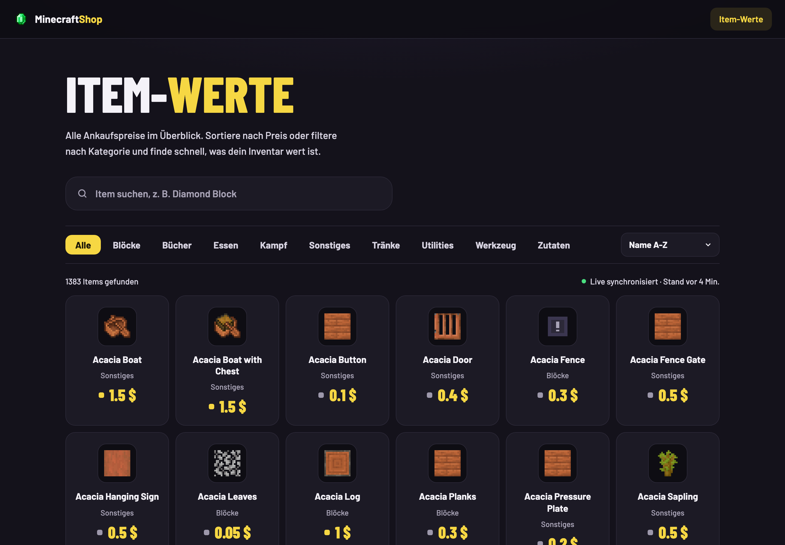
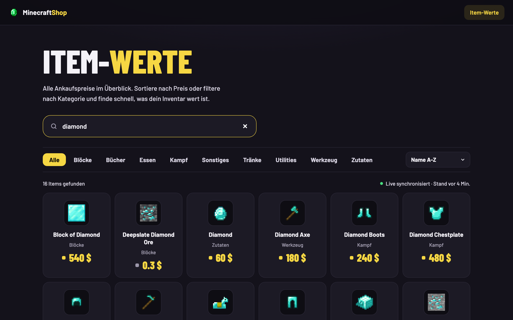
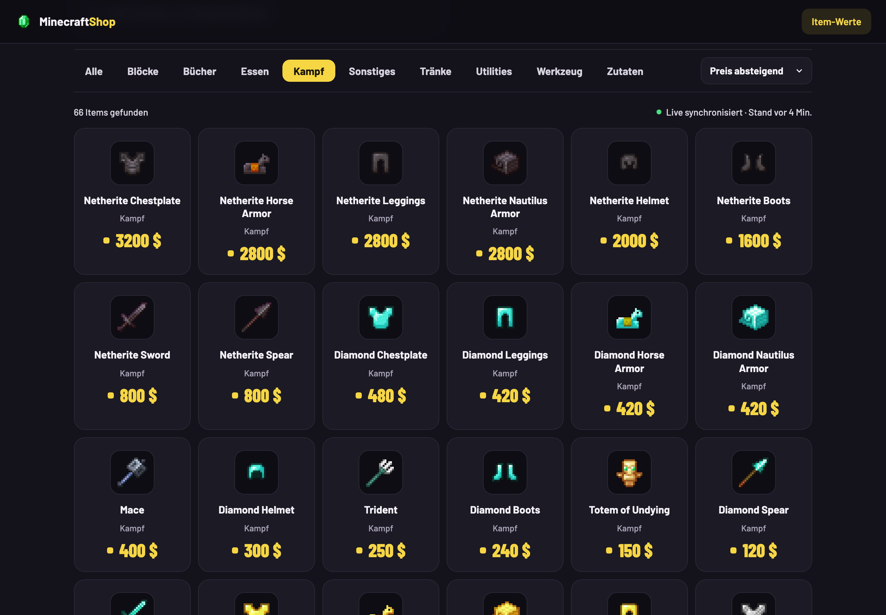
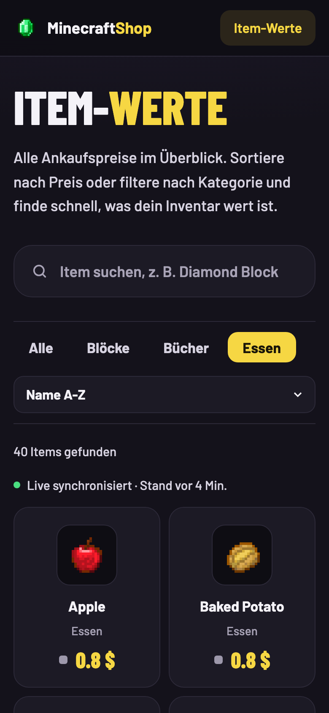

# MinecraftShop – Item-Werte

Übersicht aller Ankaufspreise eines Minecraft-Servers: Suche, Kategorien, Sortierung, Endlos-Scrollen.
Spring Boot 4 · Java 25 · PostgreSQL · Flyway · Docker Compose.



<table>
  <tr>
    <td width="50%"><p align="center"><b>Live-Suche</b></p></td>
    <td width="50%"><p align="center"><b>Kategorien &amp; Sortierung</b></p></td>
  </tr>
</table>

<p align="center">
  <br>
  <b>Mobile</b>
</p>

## Starten

**Alles in Docker** (App + Datenbank):

```bash
docker compose --profile app up --build
```

→ http://localhost:8080

**Entwicklung aus der IDE:** `MinecraftshopApplication` starten. Spring Boot startet die Postgres aus
`compose.yaml` automatisch mit (`spring-boot-docker-compose`).

**Tests** (brauchen Docker, nutzen Testcontainers):

```bash
./gradlew test
```

## Woher kommen Items und Preise?

| Was | Quelle |
|---|---|
| Item-Liste, Namen, Icons | [PrismarineJS minecraft-data / minecraft-assets](https://github.com/PrismarineJS), erzeugt mit `tools/generate_catalog.py` |
| Startpreise | Heuristik im Generator (Material × Item-Art) – nur Platzhalter |
| Echte Preise | Vom Minecraft-Server per `PUT /api/items/prices` |

Beim App-Start legt `ItemCatalogImporter` alle Items aus `catalog/items.csv` an, die noch fehlen.
Bestehende Preise werden nie überschrieben.

**Neue Minecraft-Version:** `python3 tools/generate_catalog.py 26.2` → App neu starten.

### Preis-Sync vom Server

```bash
curl -X PUT localhost:8080/api/items/prices \
  -H 'Content-Type: application/json' \
  -d '[{"minecraftId": "diamond", "price": 75}, {"minecraftId": "oak_log", "price": 1.2}]'
```

Antwort: `{"updated": 2, "unknownMinecraftIds": []}`

## API

| Methode | Pfad | Beschreibung |
|---|---|---|
| GET | `/api/items?q=&category=&page=&size=&sort=price,desc` | Suche mit Pagination |
| GET | `/api/items/{id}` | Ein Item |
| GET | `/api/items/status` | Anzahl + letzte Preisänderung |
| GET | `/api/categories` | Kategorien mit Anzeigenamen |
| POST | `/api/items` | Item anlegen |
| PUT | `/api/items/{id}` | Item ändern |
| PUT | `/api/items/prices` | Preise synchronisieren |
| DELETE | `/api/items/{id}` | Item löschen |

> ⚠️ Die schreibenden Endpunkte sind noch nicht abgesichert (Spring Security fehlt noch).

## Lizenz

[PolyForm Noncommercial 1.0.0](LICENSE.md) – frei für private und nicht-kommerzielle Nutzung.
**Kommerzielle Nutzung nur nach vorheriger Absprache.**

Minecraft-Texturen in `src/main/resources/static/icons` © Mojang Studios, nicht von dieser Lizenz umfasst.
Nicht offiziell mit Mojang oder Microsoft verbunden.
